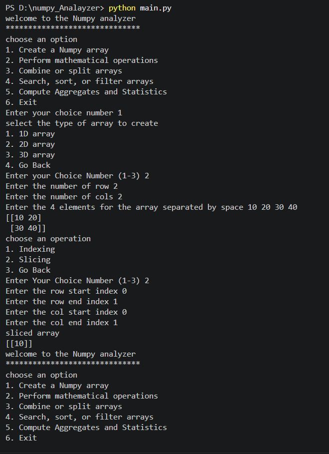

NumPy Analyzer

A menu-driven Python application that allows users to create and analyze NumPy arrays using various operations such as indexing, slicing, mathematical calculations, combining, splitting, searching, sorting, filtering, and statistical analysis.

📌 Project Overview

The NumPy Analyzer is a beginner-friendly Python project developed using the NumPy library. It provides an interactive, console-based menu that allows users to perform different operations on one-dimensional (1D), two-dimensional (2D), and three-dimensional (3D) NumPy arrays.

The project demonstrates the practical use of NumPy functions and basic Python programming concepts, including classes, methods, loops, conditional statements, exception handling, and user input.

✨ Features
1. Create NumPy Arrays
Create 1D arrays.
Create 2D arrays by specifying the number of rows and columns.
Create 3D arrays by specifying the number of layers, rows, and columns.
Enter array elements through the console.
2. Indexing and Slicing
Access individual elements using their indices.
Perform indexing on 1D, 2D, and 3D arrays.
Extract portions of an array using slicing.
Specify start and end indices for each dimension.
3. Mathematical Operations

Perform element-wise mathematical operations between two arrays of the same shape:

Addition
Subtraction
Multiplication
Division, with a check for division by zero
4. Combine and Split Arrays
Combine two arrays vertically using np.vstack().
Split an array into multiple subarrays using np.array_split().
5. Search, Sort, and Filter
Search for a specific value using np.argwhere().
Sort array elements using np.sort().
Filter elements based on conditions:
Greater than a specified value
Less than a specified value
Equal to a specified value
6. Aggregates and Statistics

Calculate basic statistical values:

Sum: Calculate the total of all array elements.
Mean: Calculate the average of the elements.
Median: Find the middle value of the sorted elements.
🛠️ Technologies Used
Programming Language: Python
Library: NumPy
Interface: Command-line interface (CLI)
📋 Requirements
Python 3.8 or later
NumPy
🚀 Installation and Setup
Step 1: Install Python

Download and install Python from the official website:

https://www.python.org/downloads/

Verify the installation:

bash
python --version

Step 2: Install NumPy

Run the following command in your terminal:

bash
pip install numpy

Step 3: Download or Clone the Project

If the project is hosted on GitHub, clone the repository:

bash
git clone <your-repository-url>

Navigate to the project directory:

bash
cd <project-folder>

Alternatively, save your Python source code in a file named numpy_analyzer.py.

Step 4: Run the Application

Execute the following command:

bash
python numpy_analyzer.py

🖥️ Application Menu

When the program starts, the following main menu is displayed:

text
Welcome to the NumPy Analyzer
******************************
Choose an option

1. Create a NumPy array
2. Perform mathematical operations
3. Combine or split arrays
4. Search, sort, or filter arrays
5. Compute aggregates and statistics
6. Exit

Select an option by entering its corresponding number.

📖 Example Usage
Example 1: Create a 1D Array

Input:

text
Enter your choice number: 1

Select the type of array to create
1. 1D array
2. 2D array
3. 3D array
4. Go Back

Enter your Choice Number: 1
Enter the element: 10 20 30 40 50

Output:

text
[10 20 30 40 50]

Example 2: Perform Array Addition

Suppose the first array is:

python
[10, 20, 30]

Enter the elements of the second array:

text
5 10 15

Output:

text
First array
[10 20 30]

Second array
[ 5 10 15]

Sum of addition
[15 30 45]

Example 3: Calculate Statistics

For the array:

python
[10, 20, 30, 40, 50]

The results are:

Operation	Result
Sum	150
Mean	30.0
Median	30.0
📂 Project Structure
text
numpy-analyzer/
│
├── numpy_analyzer.py   # Main Python application
└── README.md           # Project documentation
└── output.png          # Project output

📸 Program Output

The following image shows the program output:

---

🧠 Concepts Demonstrated

This project helps demonstrate the following programming concepts:

Python classes and objects
Methods and function calls
NumPy array creation and manipulation
Array dimensions and shapes
Indexing and slicing
Mathematical operations on arrays
Searching, sorting, and filtering
Basic statistics and aggregation
Loops and conditional statements
Exception handling
Console-based menu-driven programming

🔮 Future Improvements

The project can be enhanced with the following features:

Support for floating-point and decimal array elements.
Matrix multiplication and other advanced mathematical operations.
Transpose and reshape operations.
Minimum, maximum, standard deviation, and variance calculations.
Save arrays to files and load previously saved arrays.
Improved input validation and descriptive error messages.
A graphical user interface (GUI).
Support for combining arrays along different axes.

⚠️ Notes and Limitations
Array elements are currently accepted as integers.
Mathematical operations require the second array to have the same shape as the first array.
Array indexing starts at 0.
Slicing uses Python's standard start-inclusive, end-exclusive convention.
Vertical stacking requires compatible array dimensions.
Invalid input may produce an error message; robust input validation can improve the user experience.

👨‍💻 Author

Your Name

Replace this placeholder with your name or GitHub username.

📄 License

This project is intended for educational and learning purposes. You may add an appropriate open-source license, such as the MIT License, if you wish to distribute it for reuse.